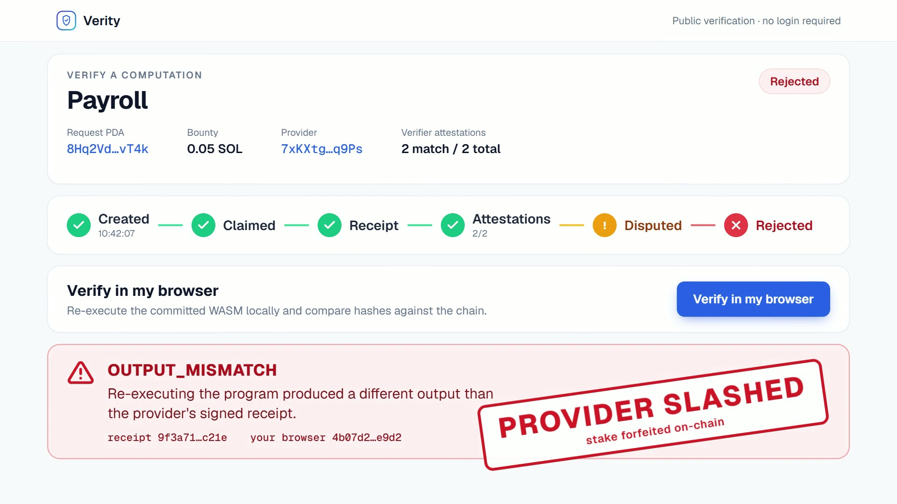
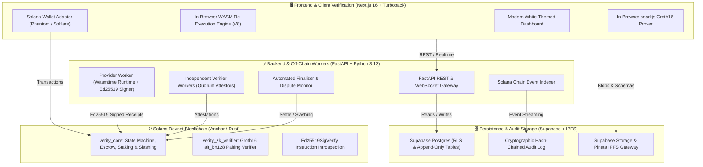
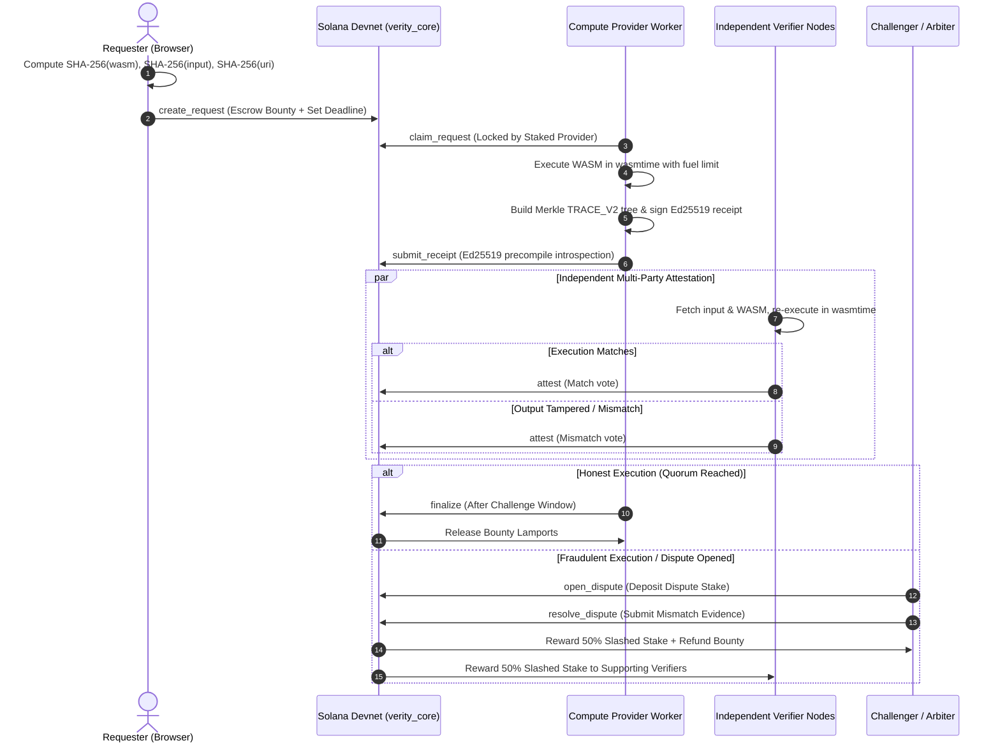

# Verity — Decentralized Verifiable Computation & Dispute Settlement Protocol

<div align="center">

[](https://explorer.solana.com/address/ByADChPce9hwCuSak9hFwiiCyndYGj7dkYypm4XYEJL1?cluster=devnet)
[](https://anchor-lang.com)
[](https://nextjs.org)
[](https://fastapi.tiangolo.com)
[](https://wasmtime.dev)
[](https://circom.io)
[](https://supabase.com)

**BitNBuild Hackathon 2026 Submission**  
**Team Name:** MorganForge  
**Team Leader:** Ashley Almeida  

*“Prove the computation, not just the result.”*

[Live Explorer](https://explorer.solana.com/address/ByADChPce9hwCuSak9hFwiiCyndYGj7dkYypm4XYEJL1?cluster=devnet) • [Architecture](#-system-architecture) • [Solana Programs](#-on-chain-solana-architecture) • [WASM Rule Sets](#-deterministic-wasm-compute-engine) • [Fraud Lab](#-adversarial-testing--fraud-simulation-lab) • [Local Setup](#-step-by-step-installation--run-guide)

---

<video src="brag-output/brag.mp4" poster="brag-output/brag.jpg" controls="controls" width="100%" style="max-width: 800px; border-radius: 12px;">
  <a href="brag-output/brag.mp4">
    
  </a>
</video>
<p>
  <a href="brag-output/brag.mp4"><strong>▶ Watch the 21s Demo Video (MP4)</strong></a> — <em>"Don't trust the provider. Check the work."</em>
</p>

---

</div>

## 📌 Executive Summary & The Problem

Modern decentralized applications and enterprise systems face a critical dilemma: **off-chain computations cannot be trusted blindly, and full on-chain re-execution is prohibitively expensive.**

When a requester delegates intensive tasks (e.g. payroll deductions, credit risk evaluations, loan amortization, or neural network inference) to off-chain compute providers, several vulnerabilities emerge:
1. **The Black Box Dilemma:** Requesters receive output without mathematical proof that the provider actually ran the agreed algorithm over the pristine input.
2. **Silent Data Tampering:** Malicious or compromised providers can subtly alter inputs, outputs, or business logic.
3. **No Economic Accountability:** Without on-chain collateral and automated slashing, bad actors face zero economic penalty for providing false answers.
4. **Blind Trust in Centralized Verifiers:** Most existing oracle and coprocessor networks require trusting a centralized committee or multi-sig.

### Verity's Solution

**Verity** is an end-to-end decentralized verifiable computation network anchored on **Solana Devnet**. It employs **cryptographic hash commitments**, **sandboxed deterministic WebAssembly (WASM)**, **multi-party optimistic verification with stake slashing**, **client-side in-browser re-execution**, and an optional **Zero-Knowledge Groth16 proof layer**.

```
Requester Commits (SHA-256 Hashes On-Chain)
           │
           ▼
Provider Claims & Runs WASM (Deterministic Wasmtime with Fuel Metering)
           │
           ▼
Provider Posts Cryptographic Receipt (Ed25519-Signed On-Chain)
           │
           ▼
Independent Verifiers Re-Execute (Multi-Party Quorum Attestations)
           │
    ┌──────┴──────────────────────────┐
    ▼                                 ▼
Consensus Reached              Dispute Triggered
Bounty Released                Stake Slashed, Challenger Rewarded
```

---

## 🏛 System Architecture

Verity is architected across four decoupled, defense-in-depth layers:



---

## 🔄 End-to-End Protocol Lifecycle



---

## ⛓️ On-Chain Solana Architecture

The protocol is powered by custom Anchor programs deployed on **Solana Devnet**.

### Deployed Contract Registry

| Contract | Address | Devnet Explorer Link |
|---|---|---|
| **`verity_core`** (Core Protocol) | `ByADChPce9hwCuSak9hFwiiCyndYGj7dkYypm4XYEJL1` | [View on Solana Explorer](https://explorer.solana.com/address/ByADChPce9hwCuSak9hFwiiCyndYGj7dkYypm4XYEJL1?cluster=devnet) |
| **`verity_zk_verifier`** (ZK Groth16) | `A5taiN69gN4EALtyM9X9S7dVMbhA5qo8aejHrfo48mVv` | [View on Solana Explorer](https://explorer.solana.com/address/A5taiN69gN4EALtyM9X9S7dVMbhA5qo8aejHrfo48mVv?cluster=devnet) |
| **Config PDA** | `Seed: ["config"]` | Min Provider Stake: `0.2 SOL`, Dispute Stake: `0.05 SOL`, Quorum: `2` |
| **Program Upgrade Authority** | `9uqynWB5rqeaqNsySnSLpxjL2Pgmet6Lqb4pSHCjmDqi` | Upgradable BPF Program Authority |

### On-Chain Account State Models

1. **`Config`**: Global protocol parameters (minimum provider stake, minimum dispute stake, challenge window in seconds, required verifier quorum, and admin authority).
2. **`Provider`**: Staked computation provider tracking active stake lamports, active job count, lifetime completed jobs, and slash history.
3. **`VerifierRecord`**: Registered independent verifiers authorized to cast consensus-counted votes.
4. **`Request`**: PDA storing `program_hash`, `input_hash`, `input_uri_hash`, `bounty_lamports`, `deadline_unix`, current status, and attestation counters (`match` vs `mismatch`).
5. **`Receipt`**: Cryptographic commitment storing `output_hash`, Merkle `trace_root`, `fuel_used`, and the Provider's Ed25519 signature.
6. **`Attestation`**: Verifier's vote recording the attested `output_hash`, whether it matched the receipt, and voting timestamp.
7. **`Dispute`**: Staked challenge against a receipt tracking `challenger_pubkey`, `challenger_stake`, and target output hash.

### Cryptographic Security Features

* **Ed25519 Instruction Introspection:** The `submit_receipt` instruction enforces that the preceding instruction in the atomic transaction is `Ed25519SigVerify111111111111111111111111111`. The Anchor program parses the transaction instructions directly to ensure the Provider's signature over `(request_id, program_hash, input_hash, output_hash, trace_root, fuel_used)` was verified by the Solana runtime.
* **Deterministic Borsh Serialization:** Hand-written Borsh codecs in the Python backend mirror the Anchor Rust structs byte-for-byte, eliminating external framework overhead.
* **Economic Slashing Guarantees:** When a Provider submits a fraudulent receipt, any challenger who stakes SOL and proves a quorum of mismatches claims 50% of the slashed collateral; the remaining 50% is distributed to the honest verifiers who attested against the fraud.

---

## ⚙️ Deterministic WASM Compute Engine

Every computation in Verity executes inside an isolated WebAssembly sandbox. To ensure bit-for-bit identical outputs across Python (server-side `wasmtime`) and JavaScript (client-side `V8`), the engine enforces strict determinism guarantees:
* **Zero System Imports:** No filesystem, network sockets, random number generators (`getrandom`), or clock access.
* **Fuel Metering:** Bound by strict execution fuel limits (`50,000,000` instructions) to eliminate infinite loops and denial-of-service vectors.
* **Integer Arithmetic:** Business logic avoids floating-point nondeterminism by standardizing on fixed-point or pure integer operations.
* **Canonical JSON (RFC 8785):** Inputs and outputs are strictly normalized with lexicographically sorted keys, compact separators, and UTF-8 encoding.

### The 6 Pre-Compiled Production Rule Sets

Verity includes 6 production-grade rule sets built with Rust and compiled to `wasm32-unknown-unknown`:

| Rule Set | Identifier / Category | Description | Inputs & Logic |
|---|---|---|---|
| **Payroll Engine** | `payroll` (Enterprise HR) | Calculates gross pay, progressive income tax brackets, social security deductions, and net compensation. | `base_salary`, `bonus`, `deductions`, `tax_bracket` |
| **Loan Amortization** | `loan_amortization` (FinTech) | Computes equal monthly installment (EMI), total interest payable, and full month-by-month debt amortization schedules. | `principal`, `annual_rate_bps`, `term_months` |
| **Tax India Engine** | `tax_india` (Compliance) | Deterministic tax calculation based on India's New Tax Regime (Section 115BAC) including standard deductions and 87A rebate. | `annual_income`, `exemptions`, `financial_year` |
| **Stats & Outlier Detection** | `stats_outliers` (Data Science) | Calculates mean, variance, standard deviation, and identifies numerical anomalies via Interquartile Range (IQR). | `numbers: [i64]`, `iqr_multiplier` |
| **Credit Risk Scorer** | `credit_risk` (DeFi & Banking) | Multi-factor risk engine computing credit scores, debt-to-income (DTI) metrics, and risk tier categorization (`Low`, `Medium`, `High`). | `credit_utilization`, `delinquencies`, `dti_ratio` |
| **Quantized ML Inference** | `ml_inference` (Edge AI) | Integer matrix multiplication executing inference for quantized neural network linear and ReLU activation layers. | `weights: [[i32]]`, `bias: [i32]`, `inputs: [i32]` |

---

## 🔒 Zero-Knowledge Proof Layer (ZK-SNARKs)

In addition to optimistic verification, Verity provides an on-chain **Zero-Knowledge Groth16** verification pipeline for confidential computations.

* **Circom Circuit:** Compiles computation constraints (`zk/circuits/payroll_compliance.circom`) verifying that a payroll calculation satisfies regulatory tax constraints without revealing sensitive employee base salaries.
* **SnarkJS In-Browser Prover:** Generates the zero-knowledge proof directly inside the user's browser in < 2.5 seconds using WebAssembly.
* **On-Chain Verifier Contract (`verity_zk_verifier`):** Implements pairing checks over the `alt_bn128` elliptic curve directly on Solana, validating the Groth16 proof against the Request PDA and hash commitments.

---

## 🛡️ Client-Side "Trust No One" Browser Verification

A core design principle of Verity is **radical verification sovereignty**. Requesters do not need to trust the backend API, the database, or even the network verifiers:

1. The Requester opens `/verify/[pda]` in the frontend.
2. The browser fetches the registered WASM bytecode and raw input from storage.
3. The client browser computes the local SHA-256 hash of both items and verifies them against the Solana on-chain account.
4. The client executes the WebAssembly module inside the browser's native WebAssembly engine.
5. The resulting output hash is checked in real-time against the Provider's on-chain `Receipt`.
6. **Verdict Display:** If the output matches, a green verified badge appears; if even a single byte differs, the interface displays an adversarial tamper warning banner with evidence diffs.

---

## 🧪 Adversarial Testing & Fraud Simulation Lab

Verity includes an interactive **Fraud Simulation Lab** accessible at `/admin`. This allows judges and developers to trigger real adversarial attacks on Solana Devnet and observe automated protocol slashing in real-time.

| Scenario | Trigger / Chaos Flag | What Happens | On-Chain Protocol Outcome |
|---|---|---|---|
| **Scenario 1: Provider Tampered Output** | `PROVIDER_TAMPER_OUTPUT` | Provider modifies computed result before signing receipt. | Verifier detects hash mismatch, casts mismatch vote; challenger opens dispute; Provider is slashed `0.2 SOL`. |
| **Scenario 2: Provider Swapped Program** | `PROVIDER_SWAP_PROGRAM` | Provider executes a different WASM program than agreed. | Receipt rejected; verifier quorum refuses attestation. |
| **Scenario 3: Storage Tampered Input** | `STORAGE_TAMPER_INPUT` | Storage layer modifies input payload after request creation. | Client and workers re-hash input; SHA-256 fails to match on-chain commitment. Request aborted. |
| **Scenario 4: Storage Tampered Output** | `STORAGE_TAMPER_OUTPUT` | Attacker alters output blob in Supabase/IPFS. | Browser and verifiers detect that `SHA-256(blob) != receipt.output_hash`. Tamper alert fired. |
| **Scenario 5: Forged Ed25519 Signature** | `PROVIDER_BAD_SIG` | Malicious actor attempts to submit receipt with an invalid signature. | Solana's `Ed25519SigVerify` instruction introspection rejects transaction on-chain with `SignatureMismatch`. |
| **Scenario 6: Lazy Verifier** | `VERIFIER_LAZY` | Verifier signs attestations without running the WASM code. | Audit checks catch diverging votes; inactive verifier stake is deactivated. |
| **Scenario 7: Frivolous Dispute** | Manual Dispute | Challenger opens a dispute against a valid, verified receipt. | Quorum confirms provider receipt; Challenger loses dispute stake (`0.05 SOL`) to the Provider. |
| **Scenario 8: Corrupted ZK Proof** | `ZK_CORRUPT_PROOF` | Attacker negates proof coordinates in the Groth16 payload. | `verity_zk_verifier` on Solana rejects the pairing equation with `InvalidProof`. |
| **Scenario 9: Merkle Trace Tampering** | Tampered Checkpoint | Attacker alters execution trace step in `TRACE_V2`. | Merkle root recomputation fails; mismatch recorded. |

---

## 💻 Tech Stack Overview

| Domain | Technologies & Libraries |
|---|---|
| **Frontend** | **Next.js 16.4** (App Router, Turbopack), **React 19**, **Tailwind CSS**, Lucide Icons, Canvas Confetti |
| **Solana & Wallets** | **@solana/web3.js**, **@coral-xyz/anchor**, Solana Wallet Adapter (Phantom, Solflare) |
| **Backend** | **FastAPI**, **Python 3.13**, Uvicorn, **wasmtime-py**, solders, httpx, APScheduler |
| **Smart Contracts** | **Rust**, **Anchor Framework 0.30.1**, Solana Devnet, Ed25519 Precompile |
| **Cryptography & ZK** | **Circom 2.1**, **SnarkJS**, Groth16, alt_bn128 curve, PyNaCl (Ed25519) |
| **Database & Cache** | **Supabase PostgreSQL**, Row-Level Security (RLS), Realtime WebSockets |
| **Storage & IPFS** | **Pinata IPFS Gateway**, Supabase Storage Buckets (`programs`, `inputs`, `outputs`) |

---

## 📂 Repository Layout

```
.
├── programs/
│   ├── verity_core/                # Main Anchor program (escrow, receipts, attestations, disputes)
│   │   ├── programs/verity_core/src/lib.rs # Core Rust contract logic & instruction introspection
│   │   └── DEPLOYMENT.md           # Contract addresses, deployment notes, devnet smoke tests
│   └── verity_zk_verifier/         # Groth16 alt_bn128 ZK verifier contract on Solana
├── rulesets/                       # Deterministic WASM rule sets written in Rust
│   ├── payroll/                    # Enterprise payroll calculation engine
│   ├── loan_amortization/          # Financial loan amortization engine
│   ├── tax_india/                  # New Tax Regime compliance engine
│   ├── stats_outliers/             # Statistical dispersion and anomaly engine
│   ├── credit_risk/                # Banking credit scoring engine
│   ├── ml_inference/               # Neural network quantized inference engine
│   └── build_all.sh                # Script building all rule sets to deterministic WASM
├── backend/                        # FastAPI application & background workers
│   ├── app/
│   │   ├── main.py                 # FastAPI application entrypoint & lifespan
│   │   ├── config.py               # Pydantic environment configuration
│   │   ├── db.py                   # Supabase client, storage, and blob management
│   │   ├── audit.py                # Hash-chained append-only audit log
│   │   ├── chain/                  # Solana RPC client, Anchor codecs, key management
│   │   ├── engine/                 # wasmtime deterministic executor & TRACE_V2 Merkle builder
│   │   ├── routes/                 # REST endpoints (requests, activity, admin, etc.)
│   │   └── workers/                # Background daemons (provider, verifier, finalizer, indexer)
│   └── tests/                      # Automated test suite (unit, offline, adversarial, ZK)
├── frontend/                       # Next.js 16 web application
│   ├── src/
│   │   ├── app/                    # App Router pages (/dashboard, /create-job, /verify/[pda], /admin)
│   │   ├── components/             # Reusable UI components, Sol buttons, dispute panels
│   │   └── lib/                    # Client-side WASM verification, Solana Web3 hooks, API client
├── zk/                             # Zero-knowledge circuit artifacts
│   ├── circuits/                   # Circom circuits
│   └── build/                      # snarkjs zkey, wasm, and verification keys
├── supabase/                       # Database migrations & RLS policy definitions
│   └── migrations/                 # Schema setup, triggers, and audit tables
└── README.md                       # Comprehensive project documentation
```

---

## 🚀 Step-by-Step Installation & Run Guide

### Prerequisites
* **Node.js**: `v20.x` or `v22.x`
* **Python**: `3.11+` (tested with Python 3.13)
* **Rust & Cargo**: (Optional, only needed if rebuilding WASM rule sets or Anchor contracts)
* **Solana Wallet**: Phantom or Solflare browser extension set to **Solana Devnet**

---

### Step 1: Clone Repository

```bash
git clone https://github.com/ashleyalmeida07/MorganForge_college_round.git
cd MorganForge_college_round
```

---

### Step 2: Configure Environment Files

#### 1. Backend Environment Setup:
Create `backend/.env.local`:
```env
# Solana Configuration
SOLANA_RPC_URL=https://api.devnet.solana.com
PROGRAM_ID=ByADChPce9hwCuSak9hFwiiCyndYGj7dkYypm4XYEJL1
ZK_PROGRAM_ID=A5taiN69gN4EALtyM9X9S7dVMbhA5qo8aejHrfo48mVv
CLUSTER=devnet

# Keypairs (Pre-configured funded devnet wallets)
PROVIDER_KEYPAIR_JSON=[190,122,9,70,48,96,242,178,88,209,160,112,122,209,163,45,60,43,22,64,180,34,61,31,33,55,117,201,251,58,244,156,147,244,55,0,13,246,133,196,105,37,121,39,179,67,154,212,48,155,19,168,195,105,96,84,26,32,70,95,166,28,89,186]
VERIFIER_KEYPAIRS_JSON=[[61,232,228,82,172,149,203,230,131,21,214,43,214,245,62,227,224,95,103,53,26,45,115,96,124,172,32,245,143,238,226,104,255,24,250,80,193,254,199,124,94,235,207,32,219,16,184,145,92,124,198,54,226,252,83,253,135,107,30,225,218,138,93,222],[10,94,162,1,5,119,241,10,81,70,99,111,46,227,71,27,52,58,252,167,143,98,16,163,22,105,19,232,174,29,15,99,58,61,48,179,230,15,160,233,28,10,187,224,255,187,201,7,188,199,73,165,29,162,27,73,11,137,7,181,121,242,166,183],[248,202,142,178,5,176,67,28,207,11,213,180,166,245,250,245,156,9,130,255,164,93,201,6,140,193,250,222,248,43,155,93,30,4,117,255,154,62,82,139,170,87,120,221,219,200,188,27,5,239,134,247,77,181,240,134,212,44,117,214,20,111,82,30]]
ADMIN_KEYPAIR_JSON=[94,223,42,177,153,116,85,207,39,19,146,6,72,126,69,240,31,46,56,99,97,72,171,118,98,31,151,248,32,249,227,22,132,103,20,9,27,206,55,235,27,48,225,5,85,169,7,17,154,8,146,148,101,172,10,55,38,92,190,192,226,166,57,153]

# Supabase Credentials
SUPABASE_URL=https://bpoqrxpbahbxiwxojlam.supabase.co
SUPABASE_ANON_KEY=eyJhbGciOiJIUzI1NiIsInR5cCI6IkpXVCJ9...
SUPABASE_SERVICE_ROLE_KEY=eyJhbGciOiJIUzI1NiIsInR5cCI6IkpXVCJ9...

# IPFS Pinata Gateway
PINATA_API_KEY=938444ad7d1a348f0e22
PINATA_API_SECRET=5bd30f290cf7fc542df48764d38c3cab8b0e4d0df94e90b59384c6c7ae1d11b0
PINATA_GATEWAY=rose-near-hummingbird-873.mypinata.cloud

# General
FRONTEND_ORIGIN=http://localhost:3000
WORKERS_ENABLED=true
```

#### 2. Frontend Environment Setup:
Create `frontend/.env.local`:
```env
NEXT_PUBLIC_API_URL=http://localhost:8000
NEXT_PUBLIC_SOLANA_RPC_URL=https://api.devnet.solana.com
NEXT_PUBLIC_PROGRAM_ID=ByADChPce9hwCuSak9hFwiiCyndYGj7dkYypm4XYEJL1
NEXT_PUBLIC_ZK_PROGRAM_ID=A5taiN69gN4EALtyM9X9S7dVMbhA5qo8aejHrfo48mVv
NEXT_PUBLIC_CLUSTER=devnet
NEXT_PUBLIC_SUPABASE_URL=https://bpoqrxpbahbxiwxojlam.supabase.co
NEXT_PUBLIC_SUPABASE_ANON_KEY=eyJhbGciOiJIUzI1NiIsInR5cCI6IkpXVCJ9...
```

---

### Step 3: Start the Backend & Background Workers

1. Open a terminal and enter the `backend` folder:
   ```bash
   cd backend
   ```
2. Create and activate a Python virtual environment:
   * **Windows (PowerShell):**
     ```powershell
     python -m venv venv
     .\venv\Scripts\Activate.ps1
     ```
   * **Linux / macOS:**
     ```bash
     python3 -m venv venv
     source venv/bin/activate
     ```
3. Install required Python packages:
   ```bash
   pip install -r requirements.txt
   ```
4. Start the FastAPI server with automated worker daemons:
   ```bash
   uvicorn app.main:app --host 0.0.0.0 --port 8000 --reload
   ```
   *The backend will boot up, connect to Solana Devnet, and start the background Provider, Verifier, Finalizer, and Indexer loops automatically.*

---

### Step 4: Start the Next.js Frontend

1. Open a second terminal and enter the `frontend` directory:
   ```bash
   cd frontend
   ```
2. Install frontend dependencies:
   ```bash
   npm install
   ```
3. Run the Turbopack development server:
   ```bash
   npm run dev
   ```
4. Open **`http://localhost:3000`** in your browser.

---

### Step 5: Run Automated Tests

To verify that all cryptographic modules, deterministic rule sets, and smart contract bindings pass:

* **Backend Unit & Cryptographic Tests:**
  ```powershell
  cd backend
  .\venv\Scripts\pytest tests/test_input_commitment.py
  ```
* **Offline Adversarial Suite:**
  ```powershell
  .\venv\Scripts\pytest tests/test_adversarial_offline.py
  ```
* **Frontend Build & TypeScript Validation:**
  ```bash
  cd frontend
  npm run build
  ```

---

## 📡 REST API Reference

| Method | Endpoint | Description |
|---|---|---|
| `GET` | `/stats` | Platform metrics (total requests, consensus rate, in-flight jobs, settled claims). |
| `GET` | `/requests?scope=all` | Query requests with status filtering, paginated with cursor support. |
| `POST` | `/requests/prepare` | Hash and store input payload in blob storage; returns cryptographic hashes. |
| `POST` | `/requests/commit-input`| Off-chain requester signature store over (program_hash, input_hash, uri_hash). |
| `POST` | `/requests/confirm` | Confirm on-chain `create_request` transaction and link to requester profile. |
| `GET` | `/requests/{pda}` | Comprehensive request inspection (hashes, receipts, attestations, disputes). |
| `GET` | `/requests/{pda}/trace` | Detailed step-by-step Merkle execution trace for an executed job. |
| `POST` | `/requests/{pda}/reverify` | Execute on-demand server-side WASM verification. |
| `GET` | `/rulesets` | List all verified deterministic WASM rule sets. |
| `GET` | `/activity` | Live audit event feed backed by cryptographic hash chains. |
| `POST` | `/admin/chaos` | Toggle chaos flags (`PROVIDER_TAMPER_OUTPUT`, etc.) for adversarial testing. |
| `POST` | `/admin/simulate` | Trigger automated simulation scenario on Solana Devnet. |

---

## 🏆 Hackathon Submission Deliverables

* **Project Title:** Verity
* **Event:** BitNBuild Hackathon 2026
* **Team Name:** MorganForge
* **Team Leader:** Ashley Almeida
* **GitHub Repository:** [ashleyalmeida07/MorganForge_college_round](https://github.com/ashleyalmeida07/MorganForge_college_round)
* **Solana Devnet Contract:** [`ByADChPce9hwCuSak9hFwiiCyndYGj7dkYypm4XYEJL1`](https://explorer.solana.com/address/ByADChPce9hwCuSak9hFwiiCyndYGj7dkYypm4XYEJL1?cluster=devnet)
* **ZK Verifier Contract:** [`A5taiN69gN4EALtyM9X9S7dVMbhA5qo8aejHrfo48mVv`](https://explorer.solana.com/address/A5taiN69gN4EALtyM9X9S7dVMbhA5qo8aejHrfo48mVv?cluster=devnet)

---

<div align="center">
Built with ❤️ by <b>MorganForge</b> for <b>BitNBuild 2026</b>.
</div>
