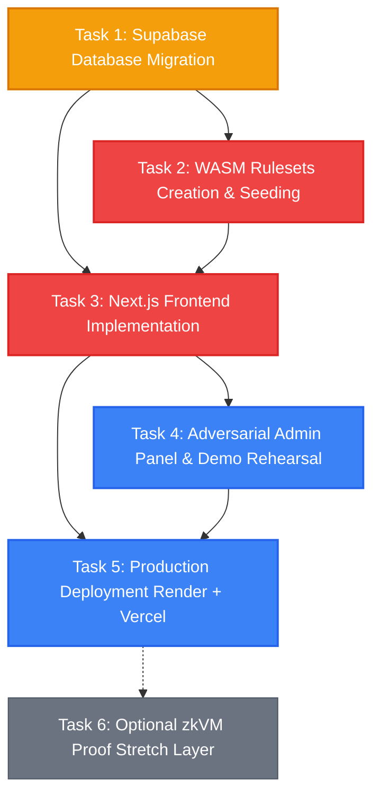

# Verity — Pending Implementation Tasks

This directory contains standalone, step-by-step implementation guides for all pending tasks required to bring Verity from its current state to a fully functional, live, end-to-end verifiable computation platform on Solana devnet.

---

## 📋 Task Index & Priority Matrix

| # | Task Document | Priority | Est. Time | Dependencies | Status |
|---|---|---|---|---|---|
| **01** | [TASK_1_SUPABASE_DATABASE_SETUP.md](./TASK_1_SUPABASE_DATABASE_SETUP.md) | **P0 (Critical)** | 30 mins | None | 🟡 Schema ready; needs database execution |
| **02** | [TASK_2_WASM_RULESETS.md](./TASK_2_WASM_RULESETS.md) | **P0 (Critical)** | 1.5 hours | Task 01 | 🔴 Crates and `.wasm` binaries needed |
| **03** | [TASK_3_FRONTEND_IMPLEMENTATION.md](./TASK_3_FRONTEND_IMPLEMENTATION.md) | **P0 (Critical)** | 4–6 hours | Tasks 01, 02 | 🔴 Next.js app needs Solana, Anchor & UI pages |
| **04** | [TASK_4_ADVERSARIAL_DEMO_AND_ADMIN.md](./TASK_4_ADVERSARIAL_DEMO_AND_ADMIN.md) | **P1 (High)** | 1.5 hours | Tasks 01, 02, 03 | 🟡 Backend & tests ready; admin UI needed |
| **05** | [TASK_5_DEPLOYMENT_AND_INFRASTRUCTURE.md](./TASK_5_DEPLOYMENT_AND_INFRASTRUCTURE.md) | **P1 (High)** | 1.5 hours | Tasks 01–04 | 🟡 Program on devnet; Vercel & Render needed |
| **06** | [TASK_6_ZKVM_PROOF_STRETCH.md](./TASK_6_ZKVM_PROOF_STRETCH.md) | **P2 (Stretch)** | 2–3 hours | Tasks 01–05 | ⚪ Optional stretch feature (SP1 zkVM) |

---

## 🗺️ Execution Sequence

---

## 📌 Current Repo Status Summary

* **Solana Program (`verity_core`)**: **95% complete**. Deployed on Solana Devnet at [`ByADChPce9hwCuSak9hFwiiCyndYGj7dkYypm4XYEJL1`](https://explorer.solana.com/address/ByADChPce9hwCuSak9hFwiiCyndYGj7dkYypm4XYEJL1?cluster=devnet). Accounts initialized, provider staked, verifiers registered, smoke tests passing.
* **FastAPI Backend**: **90% complete**. All routes, workers, wasmtime runner, signer, indexer, and adversarial test suite are written. Currently blocked on Supabase database tables and ruleset WASM files.
* **Supabase Database**: **70% complete**. `supabase/migrations/0001_init.sql` is written but has not been executed on the live Supabase instance.
* **Rule Sets**: **15% complete**. Engine is ready, but the actual Rust WASM crates (`payroll`, `loan`, `tax`, etc.) have not been created or compiled yet.
* **Frontend**: **10% complete**. Currently contains older mock boilerplate; needs Solana wallet integration, Anchor IDL, in-browser WASM verification engine, and request lifecycle pages.
